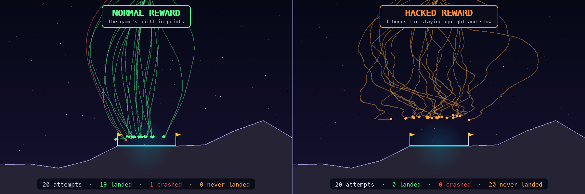

# RewardHacker

Two AI agents that design and review reward functions for a reinforcement learning agent, with every piece of AI-written code checked by a validator and trained inside a locked Docker sandbox.



## Headline results

The reward designed by the Claude agent beat the game's built-in reward. On 3 fresh training runs the agent never saw:

| | Game's reward | Claude agent's reward |
|---|---|---|
| Mean score | 142.4 | 246.2 |
| Landed | 73% | 93% |

The agent's best reward, across 3 seeds, scored **271.7 vs the baseline's 222.5**, landing 98%. Each result is averaged over 3 seeds; the samples are small, so these are solid results rather than proof.

## Environment

[Gymnasium LunarLander-v3](https://gymnasium.farama.org/environments/box2d/lunar_lander/): the agent sees 8 numbers (position, velocity, tilt, spin, leg contact) and picks one of 4 actions each frame. 200+ counts as solved. All agents are trained with PPO (Stable-Baselines3, 1M steps) and judged by a fixed evaluator that uses only the built-in reward over 20 fixed seeds.

## 1. Reward hacking

A bonus of +1 per frame for being upright and slow was meant to encourage careful flying. Instead, hovering for 1,000 frames paid more than landing, so the agent learned to never land.

| | Score | Landed | Timed out |
|---|---|---|---|
| Built-in reward | 222.5 ± 20.0 | 88% | 2% |
| Hover bonus | -30.5 ± 19.1 | 3% | 83% |

In the image above, every one of the 20 hacked flights stops just above the pad and hovers until time runs out. Video: [assets/side_by_side.mp4](assets/side_by_side.mp4)

## 2. Hand-written fixes

Both stopped the hovering, but neither beat the built-in reward. The first fix landed 100% on its first run, which turned out to be luck: across 3 runs it averaged 78%.

| Reward | Score | Landed |
|---|---|---|
| Pay for improving stability, minus a per-frame cost | 182.2 ± 59.5 | 78% |
| Potential-based shaping (Ng et al., 1999) | 168.4 ± 44.3 | 78% |

## 3. Two AI agents

- **Designer** (`agent.py`, `agent_v2.py`, `agent_v3.py`): writes a reward, trains on it, reads the results, and tries again. v1 tested each idea on one seed and was fooled by a lucky run (273 on one seed, 194 across three). v2 and v3 judge every idea across 3 seeds.
- **Critic** (`critic.py`): reviews each reward *before* training and predicts how the agent might cheat it. It flagged the hover exploit from the code alone and cleared the safe rewards. It is a useful guard, not an oracle: it missed one subtle side-effect (a penalty-only reward that caused fidgeting rather than an exploit).

In the combined loop (`agent_v3.py`), the Designer's reward is validated, reviewed by the Critic, then trained across 3 sandboxed seeds, and a detector flags hacking in the results.

## 4. Safety

Every reward, hand-written or AI-written, passes two layers before it can affect the machine:

- **Validator** (`validator.py`): parses the code without running it and blocks imports other than `math`, file and system access, `eval`/`exec`/`__import__`, private attributes, global state, `while` loops, and wrong signatures. Then it smoke-tests the function in a separate process with a timeout.
- **Docker sandbox** (`Dockerfile`, `sandbox.py`): training runs in a container with no network, a read-only filesystem, dropped Linux capabilities, no-new-privileges, and memory/CPU/time limits. It cannot see the host's files, including API keys.

`security_test.py` runs six escape attempts against this setup, from reading the `.env` file to calling the network to an infinite loop. All six are blocked.

## Scripts

- `train_with_reward.py`, `evaluate.py`: validated training and the fixed evaluator
- `validator.py`, `sandbox.py`, `security_test.py`: the safety layers and their tests
- `agent.py`, `agent_v2.py`, `agent_v3.py`, `critic.py`: the Designer and Critic agents
- `preview_style.py`, `record_side_by_side.py`, `ghost_trails.py`: visuals
- `rewards/`: every reward tested, including all agent-written ones

## Run it

```bash
python3 -m venv .venv && source .venv/bin/activate
pip install -r requirements.txt
echo 'ANTHROPIC_API_KEY="your-key"' > .env
docker build -t reward-sandbox .
python3 agent_v3.py
```
